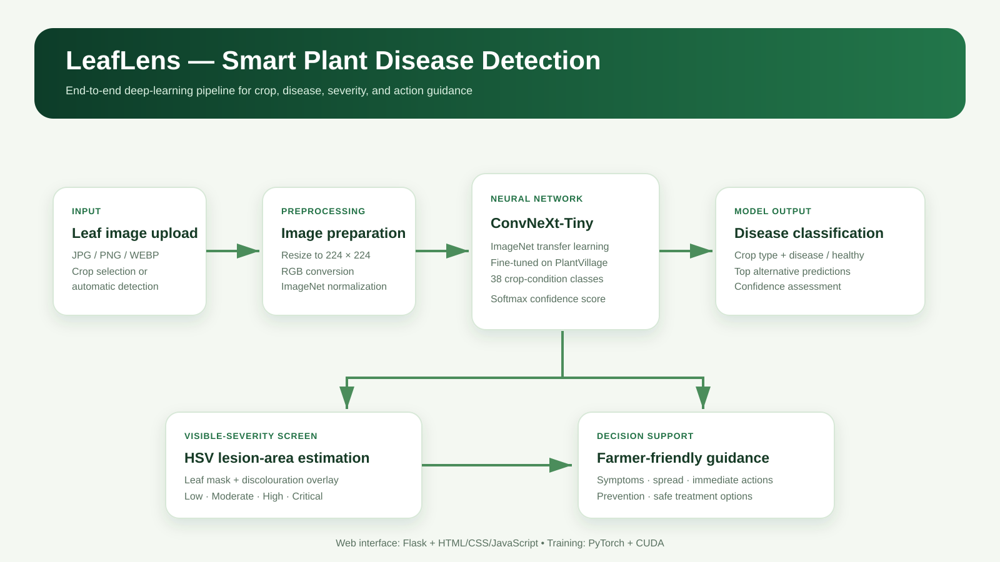

# LeafLens — Smart Plant Disease Detection

LeafLens is a deep-learning web application that screens an uploaded leaf image for its likely **crop**, **disease or healthy condition**, **model confidence**, and **visible symptom severity**. It also presents practical next steps, prevention guidance, and cautious treatment options.

> Built as a Deep Learning course project using transfer learning with ConvNeXt-Tiny and the PlantVillage dataset.

## Highlights

- **38 crop–condition classes** across **14 crop types**
- ConvNeXt-Tiny model fine-tuned from ImageNet weights
- Flask web application with a responsive HTML/CSS/JavaScript interface
- Crop selector, automatic detection, drag-and-drop image upload, and recent-search history
- Softmax prediction confidence and alternate class predictions
- HSV-based visible-damage severity screen: Low, Moderate, High, or Critical
- Disease-specific symptoms, spread, actions, prevention, and safe treatment guidance

## Result

| Metric | Result |
| --- | ---: |
| Dataset images | 54,305 |
| Crop types | 14 |
| Classes | 38 |
| Training epochs | 15 |
| Best validation accuracy | **99.83%** |

**Important:** 99.83% is validation accuracy on PlantVillage's controlled-background images. It is not a claim of real-world field accuracy. Field testing should use PlantDoc and locally collected images that were not used for training.

## Architecture



```text
Leaf photo → preprocessing → ConvNeXt-Tiny → crop + disease class + confidence
                                              ├→ HSV visible-damage screen → severity
                                              └→ knowledge base → actions and guidance
```

## Tech stack

- **Deep learning:** Python, PyTorch, Torchvision, ConvNeXt-Tiny
- **Web application:** Flask, HTML, CSS, JavaScript
- **Image processing:** Pillow, OpenCV, NumPy
- **Training hardware:** NVIDIA GeForce RTX 3050 Laptop GPU using CUDA

## Repository structure

```text
├── web_app.py              # Flask application (recommended interface)
├── train.py                # ConvNeXt-Tiny training pipeline
├── evaluate.py             # Held-out test evaluation script
├── app.py                  # Streamlit prototype interface
├── src/                    # Inference, severity, and guidance modules
├── templates/              # Flask HTML templates
├── static/                 # CSS and JavaScript
├── models/                 # Class labels and model metadata
├── data/README.md          # Dataset folder layout
└── outputs/                # Architecture diagram and report template
```

## Run the web application

```powershell
python -m venv .venv
.\.venv\Scripts\Activate.ps1
python -m pip install -r requirements.txt
```

The trained checkpoint is intentionally excluded from Git because it is large. Place it at:

```text
models/best_model.pt
```

Then run:

```powershell
python web_app.py
```

Open `http://127.0.0.1:5000`. On Windows, `run_web.bat` can also start the application.

## Train from scratch

Download PlantVillage:

```powershell
git clone https://github.com/spMohanty/plantvillage-dataset data/PlantVillage
```

Then train:

```powershell
python train.py --data data/PlantVillage/raw/color --epochs 15 --batch-size 16
```

The pipeline uses an 85/15 stratified training/validation split, ImageNet transfer learning, AdamW, label smoothing, cosine scheduling, and image augmentation.

## How prediction and severity work

The model learns from labelled PlantVillage folders such as `Tomato___Early_blight` and `Potato___Late_blight`. ConvNeXt-Tiny returns scores for all 38 labels; Softmax converts them to probabilities, and the highest-probability class is selected.

- Confidence below **65%** triggers an uncertainty warning.
- Severity is separate from confidence. It estimates visibly discoloured leaf area using HSV colour processing.
- Severity bands: **Low** `<5%`, **Moderate** `5–20%`, **High** `20–45%`, **Critical** `>45%`.

## Evaluation

Use a held-out folder-per-class dataset that was never used to choose the model:

```powershell
python evaluate.py --data data/PlantDoc_test
```

This produces a classification report and confusion matrix under `outputs/evaluation/`. Report macro F1, per-class recall, and field-test performance alongside validation accuracy.

## Limitations and responsible use

LeafLens is an educational visual-screening tool, not an agronomic diagnosis. Nutrient deficiency, pests, lighting, leaf ageing, mechanical damage, and disease can look similar. Confirm uncertain, high-impact, or regulated cases with a local agricultural extension service. Follow only locally registered product labels; the app does not provide pesticide dosage instructions.

## References

1. Hughes, D. P., & Salathé, M. (2015). *An Open Access Repository of Images on Plant Health to Enable the Development of Mobile Disease Diagnostics Through Machine Learning and Crowdsourcing.* arXiv:1511.08060.
2. Mohanty, S. P., Hughes, D. P., & Salathé, M. (2016). Using Deep Learning for Image-Based Plant Disease Detection. *Frontiers in Plant Science, 7*, 1419.
3. Singh, D., Jain, N., Jain, P., Kayal, P., Kumawat, S., & Batra, N. (2020). PlantDoc: A Dataset for Visual Plant Disease Detection.
4. Liu, Z. et al. (2022). A ConvNet for the 2020s. *CVPR.*
